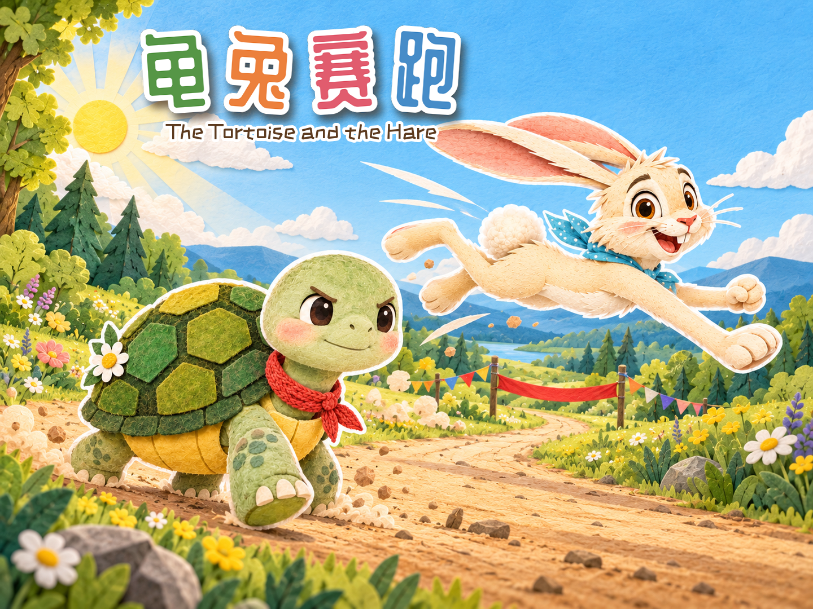
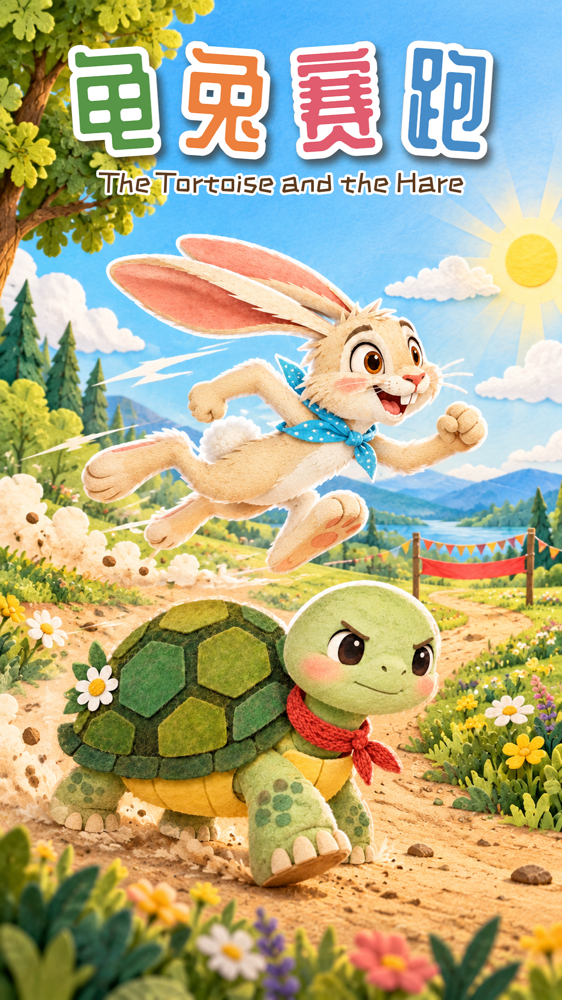

# 龟兔赛跑 · 纸艺木偶动画（v4）

<p align="center">
  
</p>

一部 **3 分 56 秒**的中文儿童短片，讲伊索寓言《龟兔赛跑》。画面是纸艺剪纸加毛毡质感，配温柔女声旁白、烧录字幕和管弦配乐。

整部片子用代码逐帧画出来，没有用动画软件。成片规格写在 `renderer/render.py` 里：**1920×1080、30 fps、H.264 + AAC**。时间轴总长 `236.40` 秒（`renderer/timeline.py` 里各幕时长之和，再加 `1.5` 秒片尾）。

画面渲染用的是 **Python、Pillow、NumPy**，多进程把原始帧送给 **ffmpeg**。配乐脚本另外用到 SciPy 和 tinysoundfont。**不用 Skia。** 更早一次用 Skia 写的渲染器已经从仓库里删除。

> **[下载 v4 成片](https://github.com/SherlockGy/tortoise-and-hare/releases/download/v4/tortoise-and-hare-v4.mp4)**（GitHub Release `v4`）。按下面的步骤可以在本地重新渲染，输出 `out/龟兔赛跑.mp4`。

## 画面里实际在做的事

- 兔子奔跑用 `assets/regen/gallop_1~4_cut.png` 四帧循环（蓄力、蹬地、腾空、落地）。`renderer/core.py` 按头部和全身质心对齐，前进距离跟步频绑在一起。
- 每张背景有一条地面线（`BG_Y`）。镜头如果会画出背景，改的是镜头自己的中心，道具和背景一起动。
- 跟拍时背景慢移、前景草快移，并画速度线和扬尘。
- 终点红丝带用生成的素材切成竖条，沿曲线摆。撞断后两半挂在立柱上。
- 字幕、旁白入点和配乐共用 `renderer/timeline.py`。配乐脚本里的哨声、断带、鼾声、心跳用的是同一套拍点。

## 封面

三种画幅各由 **Codex CLI** 单独画一张，不是从一张图裁出来的，也不是用片中角色拼的。无标题原图在 `assets/regen/covers/`。`renderer/cover.py` 按目标比例等比裁切、缩放到精确像素，再用站酷庆科黄油体写上“龟兔赛跑”，站酷快乐体写上英文副标题，存到 `covers/`。

| 横版 16:9（1920×1080） | 横版 4:3（1440×1080） | 竖版 9:16（1080×1920） |
|---|---|---|
|  |  |  |

重新生成需要本机已安装并登录 [Codex CLI](https://github.com/openai/codex)，并且 `codex` 在 `PATH` 里。脚本默认用仓库里已有的 `assets/cut/` 当角色和画风参考。当初生成时附的是未提交的绿底原图 `assets/raw/`；如果本地还有那份原图，可以设 `REF_DIR`。

```bash
cd assets/regen/covers
# 提示词：prompt_common.txt + prompt_cover_<画幅>.txt
bash gen_covers.sh                              # 生成缺失的无标题原图
rm cover_4x3.png && bash gen_covers.sh cover_4x3
# REF_DIR=/path/to/assets/raw bash gen_covers.sh
cd ../../..
python3 renderer/cover.py
# 可改裁切中心和标题位置，例如：
# python3 renderer/cover.py cover_4x3:cy=0.45,ty=0.12,tx=0.4
```

脚本里每张封面实际执行的是：

```bash
codex exec --skip-git-repo-check -s workspace-write \
  -i assets/cut/hare_stand.png -i assets/cut/hare_sprint.png \
  -i assets/cut/tortoise_stand.png -i assets/cut/tortoise_determined.png \
  -i assets/cut/bg_start.png -
```

## 目录

```
.
├── README.md
├── THIRD_PARTY_NOTICES.md
├── pyproject.toml              # 与 requirements.txt 同一份依赖
├── requirements.txt
├── covers/                     # 加过标题的封面
├── renderer/                   # 成片渲染
│   ├── timeline.py             # 13 幕时间轴、旁白入点；读取 assets/voice/voice.json
│   ├── core.py                 # 精灵、镜头、背景、字幕、奔跑/走路
│   ├── scenes.py               # 13 幕分镜
│   ├── prep.py                 # 把素材预缩放到 renderer/cache/
│   ├── render.py               # 多进程渲染、拼接、混入配乐
│   ├── cover.py                # 封面裁切 + 标题
│   └── snap.py                 # 按秒抽帧，拼成检查图
├── tools/                      # 重新生成素材、旁白、配乐（渲染不必运行）
│   ├── gen_assets.py           # Codex CLI → assets/raw/（仓库里没有这个目录）
│   ├── key_raw.py              # assets/raw/ → assets/cut/
│   ├── key_regen.py            # assets/regen/*.png → *_cut.png
│   ├── narration.py            # 旁白文稿；调用 minimax.py
│   ├── minimax.py              # MiniMax 语音接口
│   └── music.py                # 写出 out/music.wav（不是成片用的 m4a）
└── assets/
    ├── cut/                    # 已抠好的角色、背景、道具
    ├── regen/                  # 奔跑帧、红丝带、封面原图，以及生成脚本和提示词
    ├── fonts/                  # 站酷快乐体、站酷庆科黄油体
    ├── voice/                  # 43 句 wav + voice.json
    └── music/music.m4a         # 成片配乐（已混入旁白和音效）
```

`renderer/cache/`、`out/`、`assets/raw/` 由脚本生成，已写进 `.gitignore`。

## 安装

- Python 3.11 或以上
- ffmpeg，并且支持 libx264 和 AAC

```bash
python3 -m venv .venv && source .venv/bin/activate
pip install -r requirements.txt
```

依赖就是当前代码 import 的四个第三方包：`numpy`、`pillow`、`scipy`、`tinysoundfont`。`pyproject.toml` 与 `requirements.txt` 相同。NumPy 和 Pillow 用于画面；SciPy 用于抠图（`tools/key_raw.py`）和配乐（`tools/music.py`）；tinysoundfont 只用于配乐。

## 渲染

```bash
# 预缩放。读 assets/cut/*.png 和 assets/regen/*_cut.png，写入 renderer/cache/
python3 renderer/prep.py

# 整片 → out/龟兔赛跑.mp4
PROCS=6 python3 renderer/render.py

# 只渲染一段（帧号，30 fps）。下面大约是 2:45–2:48，冲线断带前后
PROCS=4 python3 renderer/render.py out/test_chunks 4950 5040 out/test_finish.mp4

# 抽几个时间点（秒）拼成检查图
python3 renderer/snap.py out/check.jpg 3 50 88 138 155 169 195 225
```

`render.py` 的参数是：`输出分段目录 [起始帧] [结束帧] [成片路径]`。分段默认 300 帧一块，进程数读环境变量 `PROCS`（默认 6）。音频从 `assets/music/music.m4a` 按起始帧对应的时间截取。

## 素材是怎么来的

渲染成片**只需要仓库里已经有的文件**。下面这些脚本用来重做素材；缺 API、缺音色库或缺 Codex 时不用跑。

1. **角色、背景、道具。** `tools/gen_assets.py` 调用 Codex CLI，把绿底或品红底原图写到 `assets/raw/`。`tools/key_raw.py` 抠图、裁边，道具拼版拆开，写到 `assets/cut/`。`assets/raw/` 没有放进仓库。`renderer/prep.py` 不读它。
2. **奔跑帧和红丝带。** `assets/regen/gen_run.sh`、`assets/regen/gen_ribbon.sh` 调用 Codex CLI，写出绿底 PNG。`tools/key_regen.py` 抠成 `*_cut.png`。这两张脚本默认参考 `assets/cut/`，也可以用 `REF_DIR` 指向自己的 `assets/raw/`。
3. **旁白。** `tools/narration.py` 通过 MiniMax `speech-2.8-hd` 合成 43 句，写 `assets/voice/*.wav` 和 `assets/voice/voice.json`。密钥放在环境变量 `MINIMAX_API_KEY`，或仓库根目录的 `.env`（不提交）。画面渲染只读 `voice.json` 的文本和时长。
4. **配乐。** `tools/music.py` 用 GeneralUser GS 音色编曲、合成音效，按时间轴把 wav 旁白铺进去并压低有人声的段落，写出 `out/music.wav`。音色库文件 `assets/sf/GeneralUser-GS.sf2` 不在仓库里。成片读的是已经做好的 `assets/music/music.m4a`（AAC）。仓库里没有把 wav 转成 m4a 的脚本。
5. **画面。** `renderer/prep.py` 预缩放。`renderer/scenes.py` 按幕放角色、镜头和粒子（扬尘、落叶、速度线、汗珠、Z、彩纸、萤火虫）。`renderer/core.py` 合成、字幕、幕与幕之间的交叉淡化。`renderer/render.py` 把帧送给 ffmpeg。
6. **封面。** 见上面的「封面」。

`assets/cut/` 里有些姿势当前分镜没有画上去（例如 `hare_run_a`、`hare_run_b`、`hare_sprint`、`hare_snore`、`tortoise_tired`、`tortoise_look_back`、鸟、云、秒表和若干小道具）。`prep.py` 仍会把目录里每一张 PNG 缩进缓存。这些文件留着，是因为它们和用到的图来自同一次素材生成。

### `assets/raw` 不在仓库里

绿底和品红底原图没有提交。没有它们就不能重跑 `tools/key_raw.py`。要重新得到那批原图，只能再跑 `tools/gen_assets.py`（需要 Codex CLI），它会新建 `assets/raw/`。

已经提交的 `assets/cut/` 和 `assets/regen/*_cut.png` 足够完成预缩放和渲染。不要把 `RAW` 指到 `assets/cut/` 再去抠图：那些文件已经是透明背景，再按绿底去抠会把图毁了。Codex 的参考图用 `assets/cut/` 是可以的，抠图输入不行。

## 版本

- **v2**：渲染改成 Pillow。兔子改用四帧奔跑。字幕放大。跟拍用视差。
- **v3**：角色走在画面里的路面和草地上。镜头出界时改镜头，终点门一类道具不再单独漂。冲线用固定机位。
- **v4**：醒来后先从山坡上看见远处很小的终点和乌龟，再拉近。猫头鹰地图的虚线终点落在旗杆底部。红丝带改用生成的素材，并做断开、垂落和摆动。

本仓库保留的是做出 v4 成片的这条管线。

## 素材与致谢

- 图像：OpenAI Codex CLI。
- 旁白：MiniMax 语音合成。
- 字体：站酷快乐体、站酷庆科黄油体（SIL OFL 1.1）。
- 音色库：GeneralUser GS（S. Christian Collins，GeneralUser GS License v2.0）。仓库未附带音色库文件。
- 故事：伊索寓言《龟兔赛跑》，公版。

详见 [THIRD_PARTY_NOTICES.md](THIRD_PARTY_NOTICES.md)。
